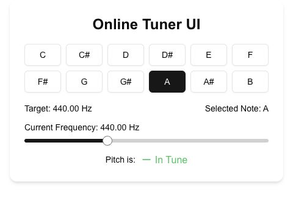
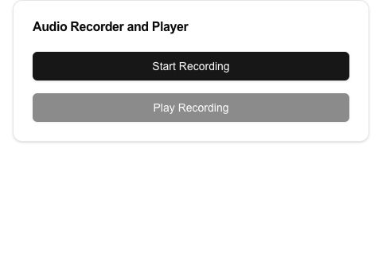

# Guitar Tuner

A CS222 team project at UIUC exploring a web-based guitar tuner and audio recorder.

## Overview

<p align="center">
  
  
</p>

*Running prototype interfaces. The tuner currently uses a placeholder pitch value; microphone recording was not enabled for these screenshots.*

## Features

- Note selection and target-frequency display.
- Pitch comparison interface.
- Browser microphone access and audio recording.
- Flask endpoints for file handling.

## Stack

Next.js · TypeScript · Flask · Web Audio API

## Audio recorder
```
npx shadcn@latest add card
```

## Tuner app

To start front end
```
cd front-end
cd my-tuner-app
npm install
npm run dev
```
To run the back end 
```
cd back-end
flask run app.py
```

Front end components: 
src/app/tuner/ : 

tuner.tsx: The tuner component that can be used as "Tuner" surounded by < > 

algorithm.tsx: The pitch detection function that accept an audio and output an frequency

test_connection/ : 

to test the connection between front end and back end

api/:
api that connects to the back end
